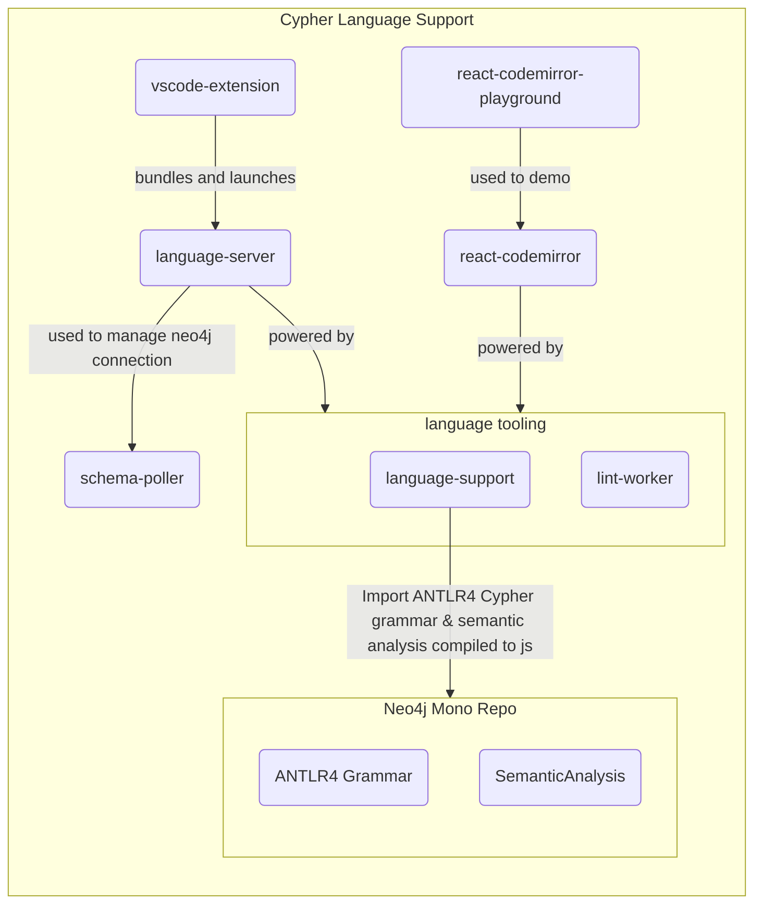

# Neo4j Cypher Language Support

This mono repo contains packages that together make up Neo4j's [Cypher](https://neo4j.com/docs/cypher/) Language support. We provide support for editors used in [Neo4j Console](https://console.neo4j.io) and also in our [VS Code extension](https://marketplace.visualstudio.com/items?itemName=neo4j-extensions.neo4j-for-vscode). 

## Capabilities

- Syntax highlighting
- Autocompletion
- Linting
- Formatting
- Signature help
- Hover information

## Project Overview

The project comprises several packages:

- [language-support](./packages/language-support/README.md) - The core library implementing the language support features.
- [language-server](./packages/language-server/README.md) - The [language server](https://microsoft.github.io/language-server-protocol/) wrapper for the `language-support` package.
- [vscode-extension](./packages/vscode-extension/README.md) - The Neo4j VS Code extension which bundles the `language-server`.
- [react-codemirror](./packages/react-codemirror/README.md) - A set of [codemirror 6](https://codemirror.net/) Cypher language support plugins and a react wrapper.
- [react-codemirror-playground](./packages/react-codemirror-playground/README.md) - A playground for the codemirror integration.
- [query-tools](./packages/query-tools/README.md) - An internal package we use to manage the Neo4j connection and keep the schema (procedure names, labels, database names, etc.) up to date in the language server.
- [lint-worker](./packages/lint-worker/README.md) - An internal package we use to create worker files for our lint jobs.

## Project status

The project is in an early stage. We are still missing features and the project is not yet stable. We welcome feedback and contributions!

Try it out in our [demo](https://neo4j.github.io/cypher-language-support/), in [Neo4j Console](https://console.neo4j.io) or in [vscode](https://marketplace.visualstudio.com/items?itemName=neo4j-extensions.neo4j-for-vscode).

## Building the project and contributing

See [CONTRIBUTING.md](./CONTRIBUTING.md).
